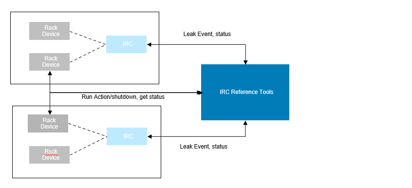
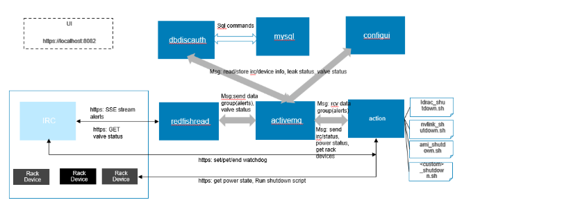
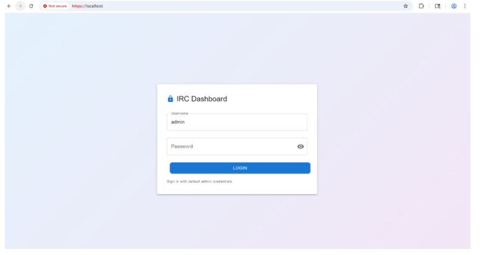
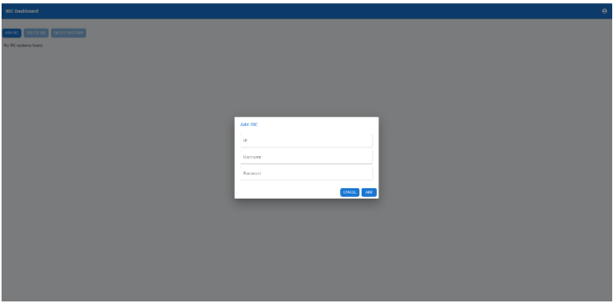
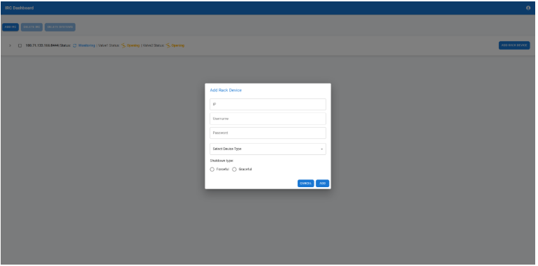
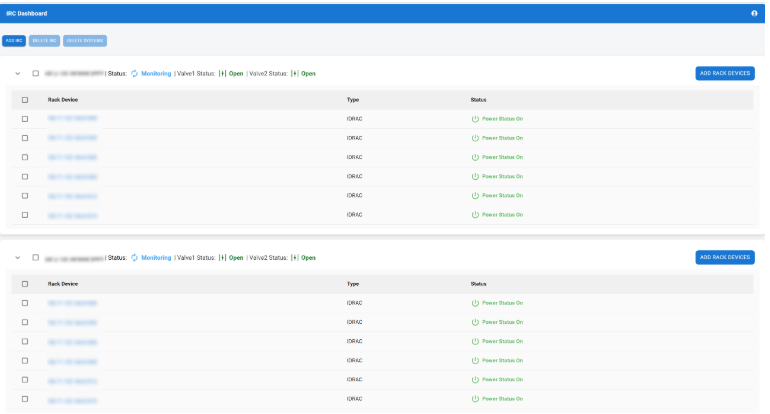
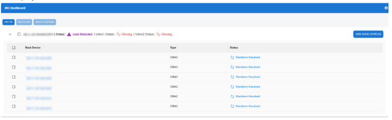
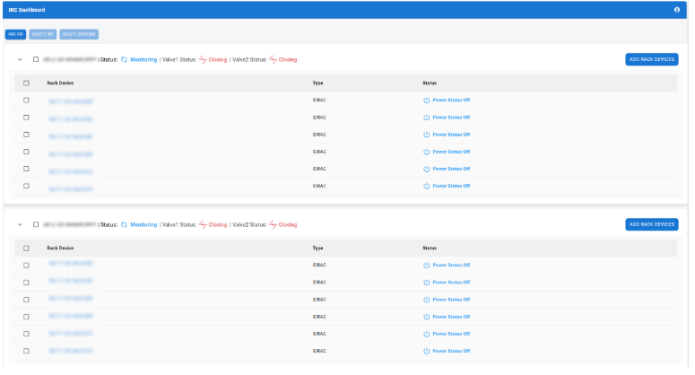

# IRC-Reference-Tools

Set of tools (docker containers) to enable customers to monitor leaks in liquid cooling subsystems for IRC-monitored rack devices and perform required actions (shutdown rack devices) to prevent damage to the devices.

> **Note:** Images in this documentation need to be updated. Current images are placeholders and will be replaced with actual screenshots.

## Solution



1. Listen for events from IRC via Redfish Server-Sent Events (SSE)
2. When leak event message is received, perform default or custom action (shutdown) on the associated rack devices
3. Display leak status and valves open/close status for each IRC in UI
4. Display shutdown operation status and power status for each associated rack device in UI

## Architecture



All containers communicate using STOMP protocol via ActiveMQ message bus. For example, when configui wants to add an IRC service, it sends an ADDSERVICE command with IRC info (IP and credentials) on the databus queue, and dbdiscauth receives the message and stores the IRC information in MySQL.

### Container Details

**activemq**: Message queue for inter-container communication using STOMP protocol.

**mysqldb**: Configuration and state persistence database. MySQL provides persistent storage for user settings, device configurations, and system state via named volume mounts.

**configui**: Web-based frontend UI for system configuration and monitoring. Runs on HTTPS port 443 with JWT-based authentication.

**dbdiscauth**: Device onboarding and authentication service. Handles ADDSERVICE/DELSERVICE commands, manages device credentials, and persists configurations to MySQL. Currently supports basic authentication (username/password).

**redfishread**: Redfish Server-Sent Events (SSE) monitoring service. Connects to IRC devices, subscribes to alert events, and publishes event data to the ActiveMQ databus queue.

**action**: Shutdown action execution service. Processes leak events and executes appropriate shutdown actions on associated rack devices based on system type configurations.

### Dynamic System Type Configuration

The system uses YAML-based configuration files to define behavior for different device types. Configuration files are located in `configs/systemtypes/` and support:

- **Built-in configurations** for common device types (iDRAC, CDU (Lantern), AMI, NVLink)
- **Custom configurations** for user-defined device types
- **Internal configurations** for parent system types

Each configuration defines:
- Power state monitoring (Redfish SSE or TCP ping)
- System ID extraction endpoints
- System information endpoints (hostname, firmware, etc.)
- Shutdown actions (graceful and force)
- IRC-specific features (watchdog, valves)

See [Custom System Types](configs/systemtypes/custom/README.md) for detailed configuration options. 

## Getting Started

For detailed setup instructions, requirements, and prerequisites, see [Setup Instructions](docs/SETUP.md).

### Quick Start

1. Clone the repository:
   ```bash
   git clone https://github.com/dell/IRC-Reference-Tools
   cd IRC-Reference-Tools
   ```
   
2. Start the system (the script handles everything automatically):
   ```bash
   bash docker-compose-files/compose.sh up
   ```
   
3. Configure the system:
   - Open `https://localhost` in your web browser
   

   - To login, default username and password is admin

   - Add IRC devices with IP and access credentials

     
 
   - Add associated rack devices with IP and access credentials

      

   - Repeat for each IRC and associated device

4. Monitor the system:
   - UI shows IRC Monitoring the Rack devices and the valve status for each IRC

     
   - UI displays current leak status and valve status for IRC

     
   - UI shows action status and power status for each rack device
   - Automatic shutdown actions occur when leak events are detected

     


## Documentation 

- [Setup Instructions](docs/SETUP.md)
- [Leak Detection and Shutdown Workflow](docs/LEAK-DETECTION-WORKFLOW.md)
- [Troubleshooting Guide](docs/TROUBLESHOOTING.md)
- [API documentation](docs/API.md)
- [Custom System Type](configs/systemtypes/custom/README.md)

## Security Considerations

- All web UI communication uses HTTPS with self-signed certificates
- Device credentials are encrypted in the database
- JWT-based authentication for web UI access
- Container network isolation via Docker bridge network
- Support for custom certificate deployment

## Monitoring and Logging

- Structured logging with configurable levels (debug, info, warn, error)
- Real-time event monitoring via Redfish SSE
- Persistent state tracking in MySQL database
- Container health monitoring via Docker
